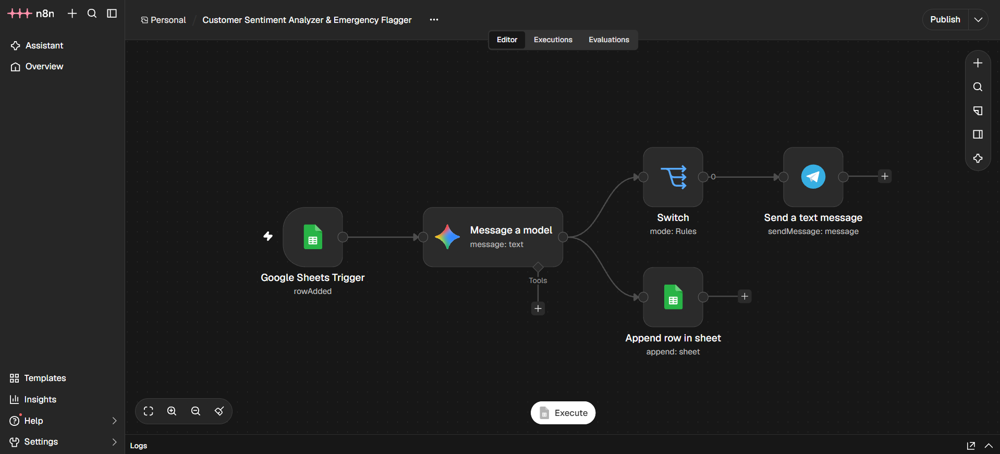

<div align="center">

# 🍱 AI-Powered Cloud Kitchen Food Waste & Predictive Procurement Engine

**An automated, $0-cost local AI supply chain pipeline that predicts next-day ingredient demand, prevents perishable spoilage, and sends nightly purchase briefings to kitchen managers.**

[](https://n8n.io/)
[](https://ollama.com/)
[](https://openweathermap.org/)
[](https://core.telegram.org/bots)
[](#)

[🎥 Watch Live Demo](#-live-end-to-end-demo) • [🏗️ Architecture](#️-system-architecture) • [🧠 AI Forecasting Rules](#-ai-supply-chain--spoilage-logic) • [🚀 Setup Guide](#-quick-setup-guide) • [📬 Contact](#-contact)

</div>

---

## 🎥 Live End-to-End Demo

Click the preview below to watch the complete workflow execution—from parallel Google Sheets & OpenWeatherMap ingestion to local **Qwen 2.5 7B** reasoning and real-time **Telegram** manager delivery:

<div align="center">
  <a href="https://youtu.be/mHDpcFTsINg?si=pSM3X2njR2f-qJ2a" target="_blank">
    
  </a>
  <br />
  <p>▶️ <a href="https://youtu.be/mHDpcFTsINg?si=pSM3X2njR2f-qJ2a" target="_blank"><b>Watch Full Walkthrough Video on YouTube</b></a></p>
</div>

---

## 🎯 Problem Statement & Business Impact

Cloud kitchens and delivery-first restaurants lose significant margins every week to two preventable issues: **over-ordering short-shelf-life perishables** (leading to spoilage waste) and **under-ordering before rainy weather** (causing stockouts during online delivery surges).

| Metric / Area | Operational Impact |
| :--- | :--- |
| **Perishable Waste Reduction** | Enforces strict shelf-life caps (`Shelf_Life_Days <= 2`) so high-risk proteins are never over-stocked to static par levels. |
| **Weather-Aware Revenue Capture** | Automatically scales demand by **1.25x (+25%)** when next-day precipitation probability reaches $\ge 50\%$. |
| **Zero Recurring Cost ($0/Month)** | Runs 100% locally via Docker, Ollama, and free-tier APIs—eliminating SaaS subscriptions and token fees. |
| **100% Data Privacy** | Sensitive restaurant sales and inventory logs never leave the local machine for LLM inference. |
| **Time Saved** | Automates nightly spreadsheet reconciliation at **10:00 PM**, saving **30–45 minutes** of manual manager prep daily. |

---

## 🏗️ System Architecture

```text
[Nightly Cron Trigger (10:00 PM)]
        ├──► [Google Sheets: Daily_Sales] ────────┐
        ├──► [Google Sheets: Current_Inventory] ──┼──► [Merge Node] ──► [JS Data Shaper]
        └──► [OpenWeatherMap: 24h Forecast] ──────┘                           │
                                                                              ▼
[Telegram Manager Alert] ◄── [JS Report Formatter] ◄── [Local Ollama: Qwen 2.5 7B]
```

### Visual Execution Preview

| n8n Automation Canvas | Telegram Manager Briefing |
| :---: | :---: |
|  |  |

---

## 🧠 AI Supply Chain & Spoilage Logic

The `Ask Qwen 2.5` node runs **`qwen2.5:7b`** in deterministic JSON mode (`temperature: 0.1`, `num_ctx: 2048`) and evaluates every raw ingredient through a 4-stage mathematical pipeline:

1. **Weighted Baseline Demand:** Blends immediate sales momentum with 7-day averages:
   $$\text{Baseline Demand} = \text{round}((\text{Units\_Sold} \times 0.4) + (\text{Avg\_Daily\_Sales\_7d} \times 0.6))$$
2. **Weather Surge Multiplier:** Sets `weather_multiplier = 1.25` if `rain_expected == true` or `max_rain_probability_percent >= 50`; otherwise `1.0`.
   $$\text{Adjusted Demand} = \lceil \text{Baseline Demand} \times \text{Weather Multiplier} \rceil$$
3. **Perishability & Spoilage Guardrail:**
   * **High-Risk Perishables (`Shelf_Life_Days <= 2`):** Caps `target_stock` at $\lceil \text{Adjusted Demand} \times 1.15 \rceil$, overriding higher `Min_Par_Level` values to prevent spoilage.
   * **Standard Items (`Shelf_Life_Days >= 3`):** Sets `target_stock = max(Adjusted Demand, Min_Par_Level)`.
4. **Net Procurement Quantity:**
   $$\text{Recommended Order Qty} = \max(0, \text{Target Stock} - \text{Current Stock})$$

---

## 🛠️ Engineering & Production Hardening

* **Docker-to-Host Network Bridging:** Configured n8n inside Docker Desktop to communicate reliably with Windows-hosted Ollama via `http://host.docker.internal:11434/api/chat`.
* **Local CPU Inference Optimization:** Tuned context window (`num_ctx: 2048`), extended HTTP node timeout to `300,000 ms`, and enabled automatic retry backoff (`maxTries: 2`, `5000 ms` wait) to guarantee zero failures during cold model loads on an AMD Ryzen 5 (16 GB RAM) machine.
* **Payload Token Compression:** Pre-processed raw 3-hour weather intervals and stripped Google Sheet metadata (`row_number`) in JavaScript before LLM inference to keep prompts compact and deterministic.

---

## 📂 Repository Structure

```text
cloud-kitchen-procurement-forecast/
├── workflows/
│   └── kitchen-procurement-workflow.json   # Sanitized, import-ready n8n workflow
├── data/
│   ├── daily_sales_sample.csv              # Sample POS daily sales schema
│   └── current_inventory_sample.csv        # Sample ingredient & shelf-life schema
├── docs/
│   ├── qwen-supply-chain-prompt.md         # System prompt & supply chain math rules
│   └── setup-and-hardening.md              # Docker networking & timeout tuning notes
├── assets/
│   ├── workflow-canvas.png                 # Full n8n execution screenshot
│   └── telegram-report-preview.png         # Formatted Telegram output preview
├── .env.example                            # Required API & environment variables template
├── .gitignore                              # Security & OS ignore rules
└── README.md                               # Project documentation
```

---

## 🚀 Quick Setup Guide

1. **Install & Pull Local LLM:**
   ```bash
   ollama pull qwen2.5:7b
   ```
2. **Set Up Google Sheets:**
   Create a workbook named `Kitchen_Procurement_Data` with two tabs (`Daily_Sales` and `Current_Inventory`) matching the CSV schemas in `/data`.
3. **Import Workflow into n8n:**
   Open your self-hosted n8n instance, create a new workflow, and import `workflows/kitchen-procurement-workflow.json`.
4. **Configure Credentials:**
   Using `.env.example` as a reference, attach your **Google Sheets OAuth2** credentials, **OpenWeatherMap API Key** (free 5-day/3-hour forecast endpoint), and **Telegram Bot Token + Chat ID**.
5. **Activate Pipeline:**
   Toggle the workflow to **Active** to trigger automated procurement briefings every night at **10:00 PM**.

---

## 🔮 Future Roadmap

* **Interactive Telegram Approval Buttons:** Upgrade the Telegram node to `Send and Wait for Response` with inline `✅ Approve Order` / `✏️ Edit Qty` callbacks that automatically log confirmed purchase orders back into Google Sheets.
* **Multi-Ingredient Recipe BOM Mapping:** Expand the inventory schema to map single menu items to multiple raw spices, oils, and packaging materials.

---

## 📬 Contact

Have questions, feedback, or want to collaborate on AI automation workflows? Feel free to reach out:

* **Email:** [ferdoushasanmaruf16@gmail.com](mailto:ferdoushasanmaruf16@gmail.com)
* **GitHub:** [@fhm16](https://github.com/fhm16)