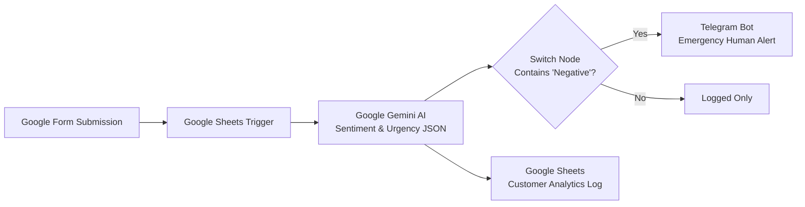
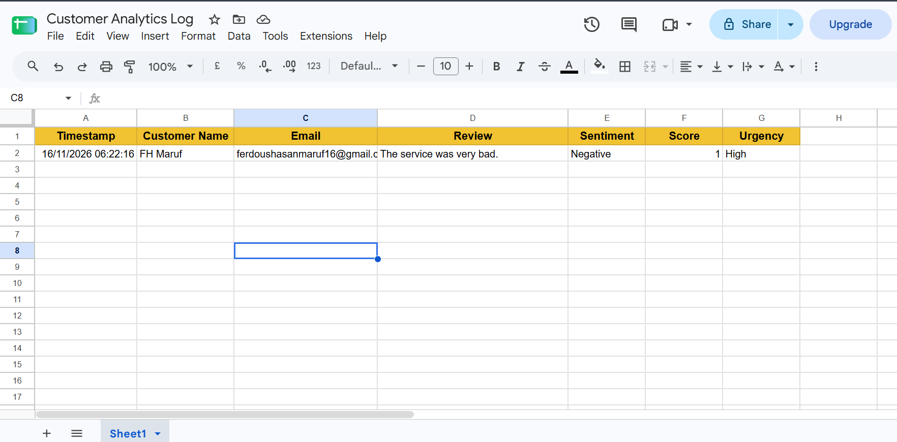

# 🚨 AI Customer Sentiment Analyzer & Emergency Alerter


A **100% zero-cost, real-time Customer Experience (CX) automation system** built with **n8n** and **Google Gemini API**. It captures incoming customer feedback, performs deterministic AI sentiment classification, triggers instant **Human-in-the-Loop (HITL)** emergency alerts on Telegram for negative reviews, and logs all structured metrics into Google Sheets for CX analytics.

---

## 🎥 Live Video Walkthrough

Watch the full end-to-end live demonstration of the workflow in action:

[](https://youtu.be/R_kQBFPZDQk?si=BCn-4X_eLFvuAjVa)

👉 **[Click here to watch the full demo on YouTube](https://youtu.be/R_kQBFPZDQk?si=BCn-4X_eLFvuAjVa)**

---

## 🎯 Business Problem & Solution

### The Problem
Businesses collecting customer feedback via forms or surveys often discover critical complaints hours or days later. Meanwhile, relying on AI to automatically reply to angry customers risks hallucinated refund promises, robotic tone, and brand damage.

### The Solution
- **Instant AI Triage:** Every new review is analyzed within seconds using `gemini-3-flash-preview` to extract **Sentiment**, **Score (1–5)**, and **Urgency**.
- **Human-in-the-Loop Escalation:** Negative reviews (`Sentiment: Negative`) bypass automated replies and immediately fire an **Emergency Alert** to the support team's Telegram with customer contact details for rapid human resolution.
- **Centralized CX Reporting:** Every single review (Positive, Neutral, and Negative) is parsed and appended to a structured **Customer Analytics Log** in Google Sheets.
- **Zero-Cost Architecture:** Built entirely on free-tier tools (self-hosted n8n, Google AI Studio Free Tier, Google Sheets, and Telegram Bot API).

---

## 🏗️ System Architecture



---

## 📸 Live System Proof

### 1. n8n Automation Workflow
End-to-end pipeline handling polling, Gemini JSON extraction, conditional routing, Telegram alerting, and parallel Google Sheets logging.


### 2. Real-Time Telegram Emergency Alert
Instant mobile notification delivered to the CX team whenever a negative review is detected.


### 3. Automated CX Analytics Log
Structured sentiment scores and urgency levels automatically recorded for reporting and trend tracking.


---

## 📂 Repository Structure

```text
ai-customer-sentiment-emergency-alerter/
├── assets/
│   ├── workflow-canvas.png          # Full n8n workflow screenshot
│   ├── telegram-alert-demo.jpg      # Live Telegram emergency notification proof
│   └── analytics-sheet-log.png      # Structured Google Sheets log output
├── data/
│   ├── sample-reviews.csv           # Sample customer feedback input
│   └── gemini-output-example.json   # Deterministic JSON output from Gemini
├── docs/
│   ├── setup-guide.md               # Step-by-step deployment instructions
│   └── prompt-engineering.md        # JSON prompt design & HITL architecture notes
├── workflows/
│   └── customer-sentiment-analyzer.json  # Sanitized, import-ready n8n workflow
├── .env.example                     # Required environment variables template
├── .gitignore                       # Security rules to exclude secrets & raw backups
└── README.md                        # Project overview & documentation
```

---

## 🚀 Quick Start

1. **Clone this repository:**
   ```bash
   git clone [https://github.com/fhm16/ai-customer-sentiment-emergency-alerter.git](https://github.com/fhm16/ai-customer-sentiment-emergency-alerter.git)
   ```
2. **Import the Workflow into n8n:**
   - Open n8n and import `workflows/customer-sentiment-analyzer.json`.
3. **Connect Your Free-Tier Credentials:**
   - **Google Sheets:** Connect OAuth2 credentials for both the Input Form Sheet and the Analytics Log Sheet.
   - **Google Gemini:** Add your free API key from [Google AI Studio](https://aistudio.google.com/).
   - **Telegram:** Add your Bot Token from `@BotFather` and set your target `Chat ID`.
4. **Activate:** Toggle the workflow to **Active** in n8n.

👉 For detailed configuration steps, read the **[Step-by-Step Setup Guide](docs/setup-guide.md)** and **[Prompt Engineering Notes](docs/prompt-engineering.md)**.

---

## 🛡️ Security & Privacy Best Practices
- All sensitive API keys, OAuth tokens, Spreadsheet IDs, and Telegram Chat IDs have been sanitized from `workflows/customer-sentiment-analyzer.json`.
- `.gitignore` is pre-configured to prevent accidental commits of `.env` files or raw local workflow exports.

---

## 📬 Contact & Connect

- **GitHub:** [@fhm16](https://github.com/fhm16)
- **Email:** [ferdoushasanmaruf16@gmail.com](mailto:ferdoushasanmaruf16@gmail.com)
